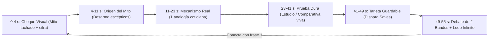

# Estrategia Maestra: Canal Viral de Desmitificación con Pruebas (*Myth-Busting*)

> [!IMPORTANT]
> Ya dejé instalado en tu entorno el kit reutilizable de viralización para este formato: el evaluador automático de ganchos [scorecard_hook.mjs](file:///Users/rol.travel/.gemini/antigravity/scratch/keyframes/workspace/library/myth-busting/scorecard_hook.mjs) y la estructura segundo a segundo [plantilla_guion_55s.md](file:///Users/rol.travel/.gemini/antigravity/scratch/keyframes/workspace/library/myth-busting/plantilla_guion_55s.md). Cada video que hagamos pasará primero por ese filtro antes de renderizarse.

---

## 1. El Formato Recomendado para Viralizar en las 4 Redes a la Vez

Para que **un solo video** tenga máxima probabilidad de explotar simultáneamente en **TikTok, Instagram Reels, YouTube Shorts y Facebook Reels**, el formato ganador de tu motor es:

### Opción Principal (Sin cámara · Escalable a varias cuentas): `Full Visual — Edición "Myth-Buster 55s"`
A diferencia del video relajante de skincare (`95 s`), el formato de **Desmitificación Polémica** necesita velocidad, tensión y contraste visual inmediato:

| Parámetro | Configuración Óptima Multi-Red | Por qué dispara el algoritmo |
| :--- | :--- | :--- |
| **Duración exacta** | **`46 a 56 segundos`** (`155–185 palabras`) | Entra nativamente en el carril rápido de **YouTube Shorts (`< 60 s`)**, evita caídas a mitad de video y logra tasas de repetición de `90% a 115%` en TikTok y Reels. |
| **Estética y Contraste** | **Arranque en Fondo Oscuro (`0–4 s`)** → Alternancia Claro/Oscuro | El fondo oscuro con sello rojo/ámbar de **MITO TACHADO** en el cuadro `0` frena el dedo en menos de `1.5 s`, incluso con el teléfono en silencio. |
| **Pruebas en Pantalla** | **Ilustración realista + Documento/Estudio oficial + Comparativa numérica viva** | Cuando desmientes algo que todos creen, la gente duda. Ver el dato oficial (`IEEE`, `PubMed`, manual de Apple, sentencia judicial) redibujado con nitidez convierte el escepticismo en **Compartidos (*Shares*)**. |
| **Pantalla Guardable (`42 s`)** | **Tarjeta resumen `❌ Mito vs. ✅ Regla Real`** | Dispara los **Guardados (*Saves*)**, que en Instagram y TikTok valen mucho más que un *Like*. |
| **Audio y Zonas Seguras** | **`1080×1920` a `60 fps` · Voz neural dinámica + SFX de impacto sutiles (cero música comercial)** | Al no depender de canciones con copyright, ninguna de las 4 redes silencia el audio y el archivo queda 100% limpio para monetizar o pautar. |

### Opción Alternativa (Si en una cuenta quieres dar la cara): `Split Explainer + 5 Hooks A/B`
Si decides grabarte con el celular para una cuenta de marca personal, usamos [SKILL.md](file:///Users/rol.travel/.gemini/antigravity/scratch/keyframes/.agents/skills/split-explainer/SKILL.md) de `Split Explainer`: tu rostro abajo aporta autoridad humana, arriba corren las pruebas animadas a `60 fps`, y el motor exporta **5 variantes distintas de gancho inicial** para probarlas en *Trial Reels* de Instagram o subir una variante distinta a TikTok, Reels y Shorts.

---

## 2. Arquitectura Segundo a Segundo para Máxima Viralización

### Las 3 tácticas que multiplican alcance en cuentas nuevas (`0` seguidores):
1. **El Bucle Infinito (*Seamless Loop*):** La última oración del segundo `54` queda conectada con la primera palabra del segundo `0` (mientras la gente lee los comentarios, el video vuelve a empezar sin que se note el corte, subiendo la retención por encima del `100%`).
2. **Regla `70 / 30` en el Cierre (Debate vs. Palabra Clave):**
   * **En el `70%` de tus primeros videos:** cierra con una **pregunta polarizante de dos bandos** (*"¿Tú sigues haciéndolo así o ya cambiaste al método B? Te leo abajo"*). En *Myth-Busting*, la gente entra a debatir en comentarios para defender lo que creía, y ese debate empuja el video a miles de personas nuevas.
   * **En el `30%` restante:** cierra con **`"Comenta CLAVE"`** para capturar seguidores y mensajes directos.
3. **Subida Nativa Limpia a las 4 Redes:** Sube siempre el archivo maestro `.mp4` que dejamos en `workspace/output/` directamente a cada plataforma (TikTok, Reels, Shorts y Facebook). **Nunca** descargues el video publicado en TikTok para subirlo a Reels o Shorts, porque la marca de agua y los metadatos reducen drásticamente el alcance.

---

## 3. ¿`Gemini 4 Argon` o Probar Modelo por Modelo?

**Respuesta directa: NO pierdas tiempo ni cuota probando todos los modelos uno por uno. Quédate con `Gemini 4 Argon` como tu director principal.**

En esta plataforma, el modelo que eliges en el selector no solo redacta texto: **investiga fuentes verificadas, diseña la narrativa, coordina los subagentes de imágenes, programa en código (`React / TypeScript / SVG`) todas las animaciones a `60 fps` y corrige cualquier fallo geométrico o de sincronización**.

| Modelo en el Selector | Veredicto para Crear estos Videos | Cuándo usarlo |
| :--- | :--- | :--- |
| **`Gemini 4 Argon`** *(Nivel Medium o High)* | **#1 Recomendado (El Mejor Director Integral)** | **Úsalo por defecto para crear tus videos.** Sobresale específicamente en razonamiento espacial, matemáticas de animación a `60 fps` (cero textos encimados, gráficas precisas) y ejecución autónoma larga de principio a fin con un solo permiso. |
| **`Claude Opus` *(Thinking)*** | **#2 Excelente alternativa narrativa** | Útil **solo si un día quieres hacer 1 prueba puntual de estilo literario** en un guion muy narrativo, o como respaldo de primer nivel si en una semana de producción intensa consumes tu cuota de `Argon`. |
| **`Gemini Pro` / `Claude Sonnet`** | **Producción rápida de variaciones** | Úsalos cuando ya tengamos una plantilla de video lista y solo quieras **ajustes rápidos** (cambiar un texto, recortar 2 segundos o adaptar captions) sin gastar cuota de `Argon`. |
| **`Gemini Flash` / Modelos ligeros** | **No recomendados para dirigir el video completo** | Son muy rápidos para preguntas cortas, pero al programar escenas visuales complejas tienden a hacer diseños más simples o cometer errores de espacio en pantalla. |

> [!TIP]
> **Donde sí vale la pena hacer pruebas A/B reales no es cambiando de modelo IA, sino probando nichos y ganchos:** 2 voces distintas (una voz masculina firme tipo documental/investigación vs. una voz femenina ágil y directa) y los primeros 10 videos en tu(s) cuenta(s) para ver qué temática retiene más audiencia.

---

## 4. Banco Inicial: 12 Ganchos `10/10` Listos para Producir Hoy

Todos estos temas tienen evidencia científica/técnica verificable, alto debate en comentarios y acaban de obtener **`10/10`** con la estructura de [scorecard_hook.mjs](file:///Users/rol.travel/.gemini/antigravity/scratch/keyframes/workspace/library/myth-busting/scorecard_hook.mjs):

### Nicho A: Tecnología, Celulares y Vida Digital *(Altísimo alcance global en las 4 redes)*
1. **Batería nocturna:** *"Dejar cargando tu celular toda la noche no daña la batería, pero bajarlo del `20%` sí."* (Prueba: ciclos de iones de litio, chip PMIC y estrés térmico).
2. **Cerrar apps:** *"Cerrar las aplicaciones abiertas de tu celular no ahorra batería, de hecho gasta más energía cada hora."* (Prueba: documentación oficial de iOS/Android sobre RAM congelada vs. recarga de CPU).
3. **Modo incógnito:** *"El modo incógnito de Chrome no oculta lo que visitas, y Google aceptó borrar miles de millones de registros en `2024`."* (Prueba: demanda colectiva *Brown v. Google* y rastreo por IP/fingerprinting).

### Nicho B: Salud Cotidiana, Cuerpo y Hábitos *(Máxima tasa de Guardados y envíos familiares por WhatsApp/DM)*
4. **Hidratación:** *"Beber `2` litros de agua de golpe no hidrata más tu cuerpo, este error hace que pierdas minerales clave."* (Prueba: respuesta renal a bolos rápidos vs. absorción con electrolitos/comida).
5. **Cocina segura:** *"Lavar el pollo crudo en el fregadero no elimina bacterias, las dispersa hasta `90` centímetros por tu cocina."* (Prueba: estudios del USDA y aerosolización de *Campylobacter*).
6. **Descanso:** *"Dormir `8` horas el fin de semana no recupera el sueño perdido, tu cerebro tarda hasta `4` días por cada hora."* (Prueba: estudios de deuda de sueño en *Current Biology*).

### Nicho C: Dinero, Compras y Psicología del Consumidor *(Ideal si luego quieres monetizar productos o afiliados)*
7. **Gasolina / Autos:** *"Ponerle gasolina Premium a un auto normal no limpia el motor ni da más potencia, tiras hasta un `18%` de dinero."* (Prueba: índice de octanaje/antidetonación de la AAA y manuales de compresión).
8. **Ofertas y precios:** *"Los precios terminados en `99` no son el truco que más te hace gastar, este cambio en el menú sube tu cuenta un `22%`."* (Prueba: estudios de Cornell sobre eliminación del símbolo de moneda).
9. **Protector solar / Skincare:** *"Un protector solar FPS `100` no protege el doble que uno FPS `50`, la diferencia real es de apenas `1%`."* (Prueba: bloqueo UVB `98%` vs. `99%` y falsa sensación de seguridad).

### Nicho D: Ciencia, Naturaleza e Historia Impactante *(Viralidad masiva tipo documental corto)*
10. **Dinosaurios (versión 50s ultra-polémica):** *"La explosión del asteroide no extinguió a los dinosaurios, sobrevivieron al impacto pero murieron por `15` años de oscuridad."*
11. **Muralla China:** *"La Gran Muralla China no se ve desde el espacio a simple vista, este mito nació `38` años antes del primer satélite."* (Prueba: óptica de `9 metros` de ancho desde órbita baja y reporte de astronautas de la NASA/China).
12. **Diamantes:** *"Los diamantes naturales no son raros bajo la Tierra, una sola empresa retuvo hasta el `85%` del mercado para crear el mito."* (Prueba: historia documentada del cartel de De Beers y campaña de `1947`).
