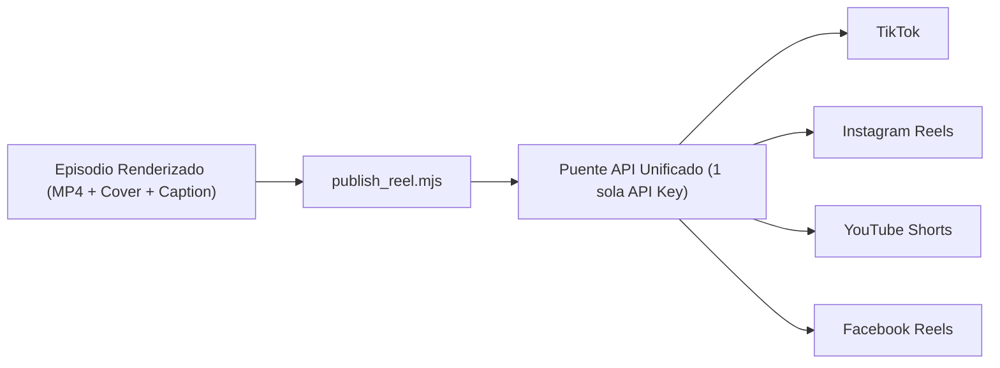

# Guía Paso a Paso: Conexión Directa y Subida Automática a las 4 Redes Sociales

Ya dejé instalado en tu proyecto el script [publish_reel.mjs](file:///Users/rol.travel/.gemini/antigravity/scratch/keyframes/workspace/library/auto-publish/publish_reel.mjs), que toma automáticamente el `.mp4` (`1080x1920 @ 60 fps`), el `cover.jpg` y el `caption.txt` de cada episodio terminado y los publica en **TikTok, Instagram Reels, YouTube Shorts y Facebook Reels**.



---

## ¿Por qué usar un Puente API Unificado en vez de 4 APIs separadas?

> [!IMPORTANT]
> Conectar por separado las 4 APIs crudas de desarrollador tiene dos bloqueos grandes al empezar:
> - **TikTok Content Posting API** exige auditoría de app empresarial y verificación de dominio web (tarda de **1 a 3 semanas**; si no está auditada, los videos suben bloqueados en modo *Privado*).
> - **Meta Graph API (Instagram + Facebook Reels)** no acepta archivos locales directos: exige subir primero el MP4 a un servidor público HTTPS (como AWS S3 o Cloudflare R2) y renovar tokens cada 60 días.
>
> En cambio, un **Puente API Unificado para desarrolladores** ya tiene la app oficial auditada por TikTok, Meta y Google: tú solo inicias sesión con tus cuentas en 2 minutos y obtienes **1 sola API Key** para subir tus `.mp4` locales directo desde aquí.

---

## Opción 1 (Recomendada · 5 Minutos): Conexión de las 4 Redes con `Upload-Post`

1. **Prepara tus cuentas antes de vincular:**
   - **Instagram:** Debe estar en modo **Cuenta de Creador** o **Empresa** (gratis desde *Ajustes → Tipo de cuenta y herramientas*) y vinculada a una **Página de Facebook**.
   - **TikTok y YouTube:** Cuentas normales con subida de Shorts/videos habilitada.
2. **Vincula las 4 cuentas con OAuth (sin dar contraseñas):**
   - Crea una cuenta en https://www.upload-post.com (tiene plan gratuito de prueba y planes API económicos para creadores) o en la alternativa open-source https://postiz.com.
   - En el panel, crea un perfil (por ejemplo `tech_mitos`) y haz clic en **Connect** para iniciar sesión con **TikTok**, **Instagram**, **YouTube** y **Facebook**.
3. **Genera tu API Key:**
   - Entra a la sección **API Keys** del panel y copia tu clave (`Apikey`) y el nombre de usuario de tu perfil (`user`).
4. **Guárdala una sola vez en tu archivo privado `.env.local`:**
   Agrega estas 4 líneas al final de [.env.local](file:///Users/rol.travel/.gemini/antigravity/scratch/keyframes/.env.local) (o pásamelas y yo las configuro por ti):
   ```ini
   PUBLISH_PROVIDER=upload-post
   UPLOAD_POST_API_KEY=tu_api_key_aqui
   UPLOAD_POST_USER=tech_mitos
   PUBLISH_PLATFORMS=tiktok,instagram,youtube,facebook
   ```
5. **Publicación automática inmediata o programada:**
   Cada vez que terminemos un episodio, se sube a las 4 redes con un solo comando:
   ```bash
   # Subir Episodio 1 (Mito: Cargar toda la noche)
   node /Users/rol.travel/.gemini/antigravity/scratch/keyframes/workspace/library/auto-publish/publish_reel.mjs /Users/rol.travel/.gemini/antigravity/scratch/keyframes/workspace/output/2026-10-30-full-visual-battery-myth

   # Subir Episodio 2 (Mito: Cerrar todas las apps)
   node /Users/rol.travel/.gemini/antigravity/scratch/keyframes/workspace/library/auto-publish/publish_reel.mjs /Users/rol.travel/.gemini/antigravity/scratch/keyframes/workspace/output/2026-10-30-full-visual-closing-apps-myth
   ```
   Y si quieres que **Antigravity genere y suba episodios automáticamente en piloto automático** (por ejemplo todos los días a las `6:00 PM`), puedes usar el comando `/schedule` (o `/automation`) en este chat una vez conectada tu API Key.

---

## Opción 2 (100% Gratuita y Directa sin Intermediarios): Solo YouTube Shorts vía Google Cloud

Si además (o para empezar hoy mismo sin ningún servicio externo) quieres conexión directa a **YouTube Shorts**:

1. Entra a https://console.cloud.google.com, crea un proyecto y activa **YouTube Data API v3**.
2. En **Credenciales → Crear credenciales → ID de cliente OAuth** (tipo *Aplicación de escritorio*), copia tu `Client ID` y `Client Secret`.
3. En https://developers.google.com/oauthplayground autoriza el alcance `https://www.googleapis.com/auth/youtube.upload` con tus credenciales propias y copia el `Refresh Token`.
4. Añade en [.env.local](file:///Users/rol.travel/.gemini/antigravity/scratch/keyframes/.env.local):
   ```ini
   PUBLISH_PROVIDER=youtube-direct
   YOUTUBE_CLIENT_ID=tu_client_id
   YOUTUBE_CLIENT_SECRET=tu_client_secret
   YOUTUBE_REFRESH_TOKEN=tu_refresh_token
   ```
   El script [publish_reel.mjs](file:///Users/rol.travel/.gemini/antigravity/scratch/keyframes/workspace/library/auto-publish/publish_reel.mjs) ya incluye el cliente OAuth2 resumable nativo de YouTube (`categoryId: 28` *Science & Technology* + etiqueta `#Shorts`).
