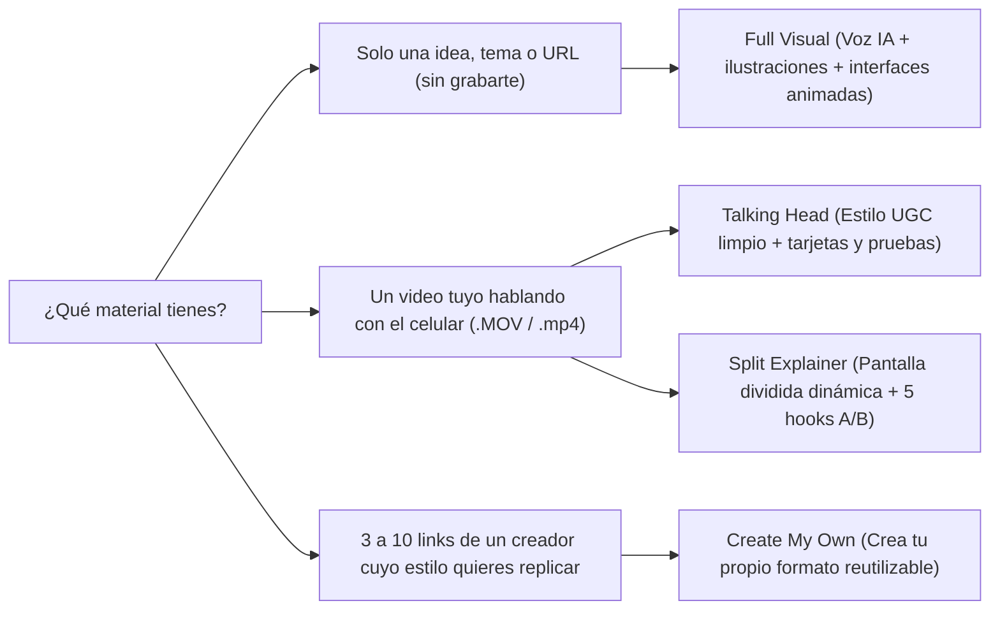

# Guía de Formatos y Videos Virales con Keyframes

Tu entorno en [runtime.json](file:///Users/rol.travel/.gemini/antigravity/scratch/keyframes/runtime.json) cuenta con **3 motores de producción** ([SKILL.md](file:///Users/rol.travel/.gemini/antigravity/scratch/keyframes/.agents/skills/full-visual/SKILL.md) de `Full Visual`, [SKILL.md](file:///Users/rol.travel/.gemini/antigravity/scratch/keyframes/.agents/skills/talking-head/SKILL.md) de `Talking Head` y [SKILL.md](file:///Users/rol.travel/.gemini/antigravity/scratch/keyframes/.agents/skills/split-explainer/SKILL.md) de `Split Explainer`) más el **clonador de formatos** ([SKILL.md](file:///Users/rol.travel/.gemini/antigravity/scratch/keyframes/.agents/skills/create-my-own/SKILL.md) de `Create My Own`).

---

## 1. Instrucciones según el tipo de video que quieras hacer

### A. Videos tipo UGC (Contenido auténtico grabado con celular)
El formato UGC funciona porque parece la recomendación honesta de una persona real y no un anuncio tradicional.

* **Qué motores usamos:** `Talking Head` (encuadre completo con subtítulos dinámicos, gancho en el cuadro `0` y tarjetas/pruebas sincronizadas) o `Split Explainer` (alterna entre tu rostro abajo y la demostración arriba o a pantalla completa, entregando **5 variantes distintas de gancho inicial**).
* **Cómo grabarte (2 minutos):**
  1. Graba en vertical (`9:16`) con buena luz frente a una ventana o lámpara, hablando natural.
  2. **No detengas la grabación si te equivocas:** simplemente haz una pausa de 1 segundo y repite la frase. El motor elimina automáticamente silencios, respiraciones y tomas repetidas **sin acelerar tu voz**.
  3. Guarda el archivo `.MOV` o `.mp4` en [input](file:///Users/rol.travel/.gemini/antigravity/scratch/keyframes/workspace/input) (o dime en qué carpeta está; el sistema trabaja sobre una copia sin tocar tu original).
* **Cómo pedírmelo (copia y pega):**
  > *"Tengo un video crudo en `[ruta del archivo]`. Hazme un reel estilo UGC con `Talking Head` (o `Split Explainer` con 5 ganchos) en español, resaltando el problema al inicio, mostrando imágenes/datos reales de `[producto/tema]` cuando los mencione y cerrando con el llamado a comentar `[PALABRA]`."*

---

### B. Videos de Información de Productos (E-commerce, Apps, SaaS o Servicios)
Tienes **dos modalidades** según quieras salir en cámara o no:

| Modalidad |Qué necesitas darme | Qué construye el sistema |
| :--- | :--- | :--- |
| **Sin rostro (`Full Visual`)** | Nombre o URL del producto, beneficios clave, precios/datos reales y (opcional) fotos en [input](file:///Users/rol.travel/.gemini/antigravity/scratch/keyframes/workspace/input). | Locución en español, subtítulos palabra por palabra, interfaz o ficha del producto redibujada en alta nitidez, comparativa animada de precios/resultados, ilustraciones de uso y cierre interactivo. |
| **Con presentador (`Split Explainer`)** | Un video tuyo hablando del producto + enlace o fotos del producto. | Edición limpia de tu toma + pantalla dividida donde arriba se anima el producto, ingredientes, capturas reales o gráficos justo en la palabra exacta + 5 hooks para testear anuncios o *Trial Reels*. |

* **Cómo pedírmelo (sin cámara):**
  > *"Hazme un `Full Visual` en español sobre este producto: `[nombre o link]`. Enfócalo en resolver `[problema principal]`, compara sus números frente a `[alternativa tradicional]`, incluye imágenes ilustrativas de cómo funciona y cierra pidiendo comentar `[PALABRA]` para enviarles el enlace."*

---

### C. Videos sobre Historias y Storytelling (Ciencia, Casos Reales, Negocios, Historia, Crímenes/Misterios)
Es la evolución narrativa del video que acabamos de crear sobre los dinosaurios.

* **Estructura narrativa que usa el motor ([SKILL.md](file:///Users/rol.travel/.gemini/antigravity/scratch/keyframes/.agents/skills/full-visual-script/SKILL.md)):**
  1. **Gancho de choque (`0–4 s`):** Desmiente una creencia común o abre un misterio concreto con una cifra real.
  2. **Puente (`4–12 s`):** Ubica el momento, el lugar y el protagonista.
  3. **Secuencia Causa → Consecuencia (`3 a 4 escenas`):** Cada escena avanza la historia con ilustraciones cinematográficas (*"cómo se veía realmente"*) combinadas con mapas, líneas de tiempo o contadores en movimiento.
  4. **Giro revelador (*Plot Twist*):** Una frase corta que cambia la perspectiva con un dato contundente.
  5. **CTA opcional:** Comentario clave para recibir fuentes, guía o parte 2, o cierre limpio para *guardar/compartir*.
* **Cómo pedírmelo:**
  > *"Hazme un video de historia en español (`Full Visual`) sobre `[historia / caso real / suceso]`. Quiero un tono cinematográfico y descriptivo con ilustraciones realistas en cada etapa, datos verificados y duración aproximada de `[60–80]` segundos."*

---

## 2. Los 8 formatos que más se están viralizando actualmente (2026)

Hoy los algoritmos de **Instagram Reels, TikTok y YouTube Shorts** priorizan tres métricas por encima de los *likes*: **retención en los primeros 3 segundos**, **veces que se guarda (*Saves*)** y **envíos por mensaje directo (*Shares/Sends*)**. Estos son los formatos con mayor alcance orgánico y conversión:

1. **Desmitificación / Veredicto Polémico con Pruebas (*Myth-Busting*)**
   * *Ejemplo de gancho:* `"La explosión del asteroide no mató a los dinosaurios..."` o `"Dejar cargando tu celular toda la noche no daña la batería, esto sí"`.
   * *Por qué viraliza:* Rompe una creencia popular en 3 segundos, obliga a quedarse a ver la prueba y genera debate en comentarios.
2. **UGC "Problema Real → Descubrimiento Casual → Prueba en vivo"**
   * *Ejemplo de gancho:* `"Llevaba 6 meses perdiendo clientes por responder tarde en WhatsApp hasta que probé esto..."`
   * *Por qué viraliza:* No parece publicidad corporativa; activa identificación inmediata y convierte espectadores en compradores.
3. **Storytelling de "Incidente o Error Millonario" Minuto a Minuto**
   * *Ejemplo de gancho:* `"Cómo un solo renglón de código borró \$400 millones en 45 minutos"`.
   * *Por qué viraliza:* La tensión cronológica (*Paso 1 → Paso 2 → Colapso*) dispara el porcentaje de personas que ven el video hasta el último segundo.
4. **Split-Screen Dinámico con Pruebas Visuales Arriba (`Split Explainer`)**
   * *Por qué viraliza:* Combina la confianza humana de ver una cara real hablando con estímulos visuales constantes en la mitad superior, evitando que el espectador deslice.
5. **Comparativa Directa "Antes vs. Después" o "Opción Cara vs. Alternativa Inteligente"**
   * *Ejemplo de gancho:* `"Por qué la gente está cambiando su suscripción de \$60 al mes por esta herramienta gratuita"`.
   * *Por qué viraliza:* Altísima tasa de **guardados** porque el usuario quiere conservar el dato para usarlo después.
6. **Recurso Entregable + Automatización por Comentario (`"Comenta CLAVE"`)**
   * *Por qué viraliza:* Multiplica los comentarios reales en los primeros minutos de publicación y alimenta tu embudo por DM (además, la descripción del post ya incluye valor completo para posicionar en el buscador de Instagram y Google).
7. **Microseries Episódicas (*"Parte 1" / "Día 1 de 7"* o Casos por Capítulos)**
   * *Por qué viraliza:* Cuando alguien descubre un episodio, entra a tu perfil a ver los demás, multiplicando las vistas de toda tu cuenta y los nuevos seguidores.
8. **Clonación de Formato Ganador (`Create My Own`)**
   * *Cómo funciona aquí:* Si ves un creador en TikTok o Reels cuyo ritmo de cortes, zooms, subtítulos y cambios de escena está arrasando, me pasas entre **3 y 10 enlaces** de sus videos y el motor crea una habilidad a medida para aplicar esa misma estructura a tus propios videos.

---

## 3. Lista de otros tipos de videos que podemos producir juntos

| Categoría | Ideas listas para producir con tus herramientas actuales | Formato recomendado |
| :--- | :--- | :--- |
| **Ventas y E-commerce** | • Comparativa de tu producto vs. competidores • Desglose de ingredientes / materiales / tecnología interna • Respuesta en video a la objeción #1 de tus clientes (*"¿Por qué cuesta X?"*) • Unboxing / prueba honesta narrada paso a paso | `Split Explainer`, `Talking Head` o `Full Visual` |
| **Negocios, Finanzas e IA** | • Tutorial rápido de herramientas o flujos de trabajo (*3 pasos*) • Análisis de cuánto cuesta realmente un negocio o servicio por dentro • Noticias tech / IA explicadas sin tecnicismos con impacto real en el usuario | `Full Visual` o `Split Explainer` |
| **Historia, Ciencia y Curiosidades (Canales *Faceless*)** | • Grandes misterios científicos resueltos por estudios recientes • Desastres de ingeniería, aviación o expediciones históricas minuto a minuto • "¿Qué pasaría en la Tierra si...?" con simulación visual y datos reales • Biografías relámpago de inventos o decisiones que cambiaron el mundo | `Full Visual` con ilustraciones |
| **Marca Personal y Servicios (Agencias, Consultores, Salud, Viajes)** | • Caso de éxito real: de punto A a punto B con métricas animadas • *"3 errores que te están costando dinero/tiempo al hacer X"* • Itinerarios visuales, presupuestos desglosados o guías descargables por DM | `Talking Head` o `Split Explainer` |

> [!TIP]
> **¿Quieres probar otro estilo ahora mismo?** Solo dime el giro de tu marca o proyecto (por ejemplo: viajes, e-commerce, tecnología, educación o canal de curiosidades) y si prefieres **sin cámara (`Full Visual`)** o **con video tuyo (`Talking Head` / `Split Explainer`)**, y te propongo 5 ganchos virales listos para elegir.
